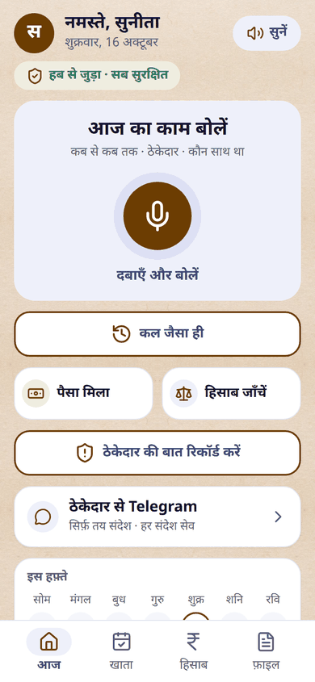
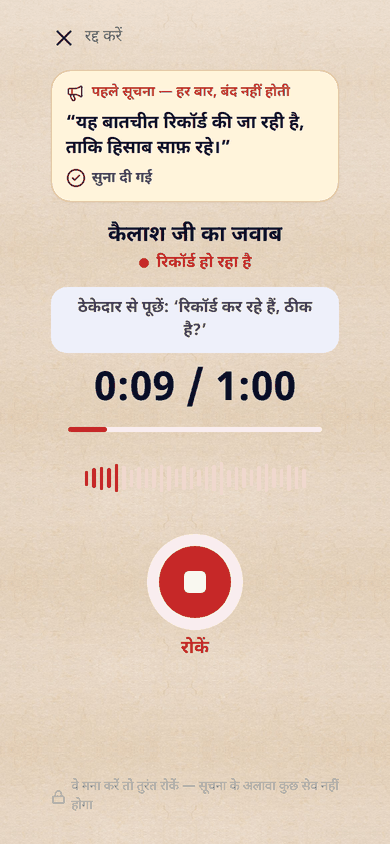
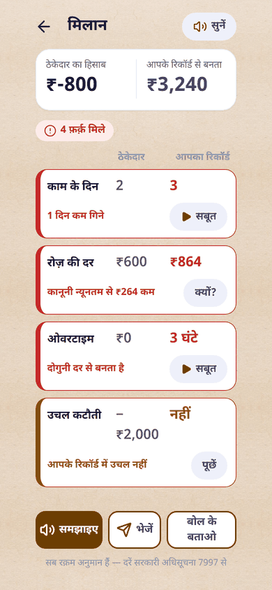
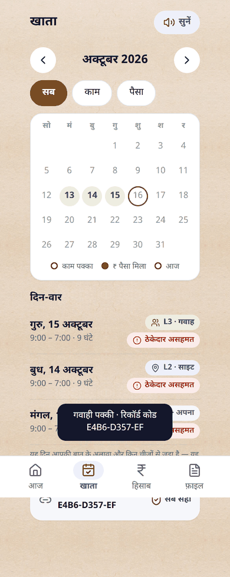
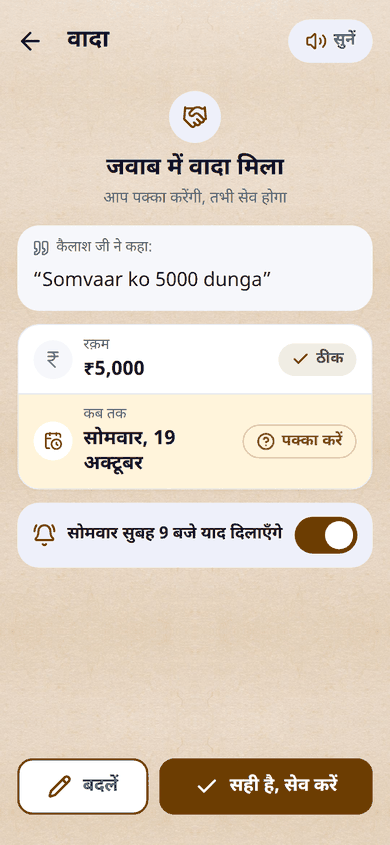
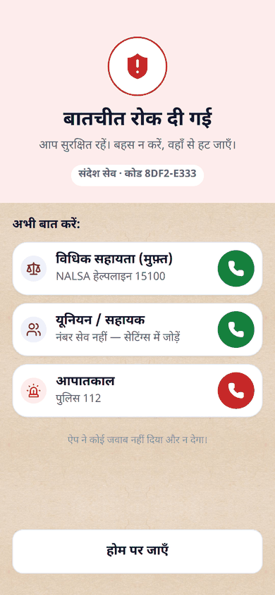
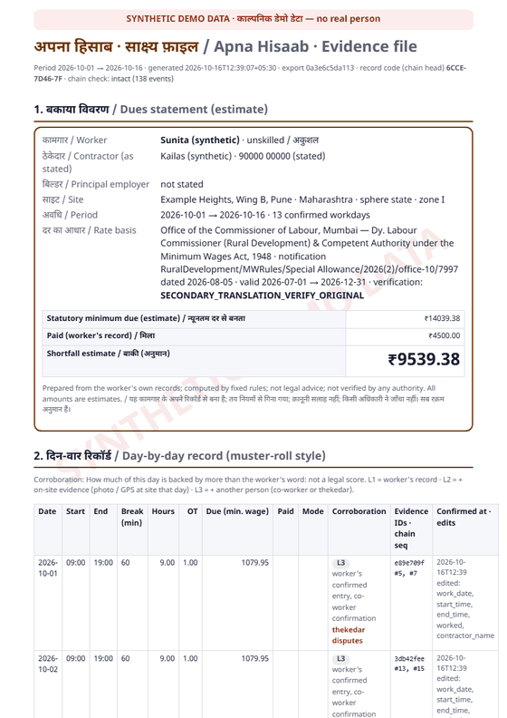

# अपना हिसाब · Apna Hisaab

**A wage-theft evidence builder for migrant construction workers** (OpenForge Hackathon, Track 1, PS07).

## 🧠 Local AI models we use (open-weight, run on our own hub)

| Job | Model | Size / quant | Runtime | License |
|---|---|---|---|---|
| **Speech → text** (Marathi / Hindi / Hinglish) | [faster-whisper-small](https://huggingface.co/Systran/faster-whisper-small) (CPU) · [whisper-large-v3-turbo](https://huggingface.co/deepdml/faster-whisper-large-v3-turbo-ct2) (GPU) | 244 M int8 · 809 M fp16 | CTranslate2 / faster-whisper | MIT |
| **Field extraction** (`{value, evidence}` only, no maths) | [Qwen3-1.7B](https://huggingface.co/Qwen/Qwen3-1.7B) (CPU) · [Qwen3-4B-Instruct-2507](https://huggingface.co/Qwen/Qwen3-4B-Instruct-2507) (GPU) | GGUF Q4_K_M | [llama.cpp](https://github.com/ggml-org/llama.cpp) `llama-server` | Apache-2.0 |

- Switched by `.env` only (`ASR_MODEL`, `ASR_DEVICE`, `LLM_MODEL`, `LLM_BASE_URL`); nothing is hardcoded.
- **No closed AI API by default.** The optional "तेज़" ChatGPT mode is off unless `CHAT_API_KEY` is set *and*
  the worker turns it on; it always falls back to the local models ([details](#optional-cloud-engine-disclosed)).
- The LLM only extracts and classifies. **All wage arithmetic is done by code** (`backend/app/wage_engine.py`).
- Full table, measured latencies and model audit: [Models](#models-all-open-weight) · [MODEL_AUDIT.md](MODEL_AUDIT.md).

A worker speaks a short daily note in Marathi, Hindi or Hinglish. The app saves and hashes the audio before
anything else, reads it with **open-weight** speech and language models, and the worker confirms each field.
Confirmed days go into a hash-chained ledger. A deterministic wage engine then compares work and pay against
the official Maharashtra minimum-wage notification. Because a worker-only diary is easy to challenge, each day
is also linked to **corroboration**: a photo and GPS at the site, a co-worker's consented confirmation, payment
slips, and **the thekedar's own words**, from a consented recording or his replies to a Telegram agent.
The output is a bilingual, hash-indexed **evidence file** a paralegal or union can use.

> *"We don't replace the employer's record — we fill the gap his missing record leaves. No internet never means no record."*

**By default no closed AI API is used.** All AI runs on open-weight models on the hub (or the phone). An
*optional* "तेज़" (fast) mode can send ASR, extraction and read-back to the ChatGPT API instead. It is off unless
`CHAT_API_KEY` is set **and** the worker turns it on in Settings, and it falls back to the local models on any
error (see [Optional cloud engine](#optional-cloud-engine-disclosed)).
The LLM only *extracts and classifies*; every number is computed by code, and every message to the thekedar
is a fixed template filled by code.

⚠️ This is **not proof** and not legal advice. It is a corroborated record with estimates, prepared from the
worker's own entries. All data in this repo, screenshots and demo is **SYNTHETIC DEMO DATA**.

| Home | Thekedar recording (notice first) | Differences (मिलान) | Ledger: L1/L2/L3 |
|---|---|---|---|
|  |  |  |  |

| Promise from Telegram (worker confirms) | Hostile message → no reply, help numbers | Evidence packet (PDF) |
|---|---|---|
|  |  |  |

---

## The problem

Construction workers in Maharashtra are paid in cash by a *thekedar* (labour contractor). Days go uncounted,
the rate sits below the legal minimum, overtime is never paid, and "advances" are deducted. The employer keeps
no muster roll, so a claim becomes the worker's word against his. Workers rarely have literacy, data, or time
for an app that needs typing.

## What it does

1. **Speak, don't type.** One tap records a note ("सकाळी नऊ ते संध्याकाळी सात…"). An optional photo and opt-in GPS are added.
2. **Save + hash first.** The phone computes SHA-256 of the original bytes and keeps the note in IndexedDB.
   **With no internet the note still saves**, and it uploads later; the hub must report the same hash.
3. **Processed in the background, one note at a time.** The hub queues each upload right after it is hashed, so a
   slow CPU, a proxy timeout or a sleeping phone never loses the work. The phone just checks back.
4. **Two readers.** Open-weight ASR → LLM extraction (`{value, evidence}`, where evidence must be an exact
   transcript substring) **and** a deterministic Hindi/Marathi number/time/date parser. Agreement shows green;
   one reader or a disagreement shows amber; nothing found shows red. The worker confirms; only confirmed values count.
5. **Ledger + hisaab.** Hash-chained events (`verify()` reports the event where a tamper happened). The wage engine uses
   exact rational arithmetic on the provenance-stamped rate pack (Maharashtra SN 11, Jul–Dec 2026). It reports the
   shortfall estimate, overtime, Form II heads, and the citation with its verification status.
6. **Corroboration level per day** (deterministic, `corroboration.py`):
   **L1** worker's record · **L2** + on-site evidence (photo / GPS within 300 m) · **L3** + another person
   (co-worker or thekedar). A thekedar dispute is shown as a flag, never hidden. *Not a legal score.*
7. **The thekedar's side.**
   * **Consented recording:** a notice ("यह बातचीत रिकॉर्ड की जा रही है…") plays automatically, can't be skipped,
     and is on the tape. If he refuses, only the notice is kept. His statement is compared with the ledger →
     `DAYS_DIFF`, `RATE_BELOW_MIN`, `OT_NOT_COUNTED`, `DEDUCTION_DISPUTED`, `PAID_DIFF`.
   * **Hisaab check:** the worker narrates what the thekedar said, or types it, and gets the same differences.
   * **Telegram agent** (a stand-in for WhatsApp, whose Business API is paid): the thekedar joins only through
     the worker's invite link/QR. The bot introduces itself and says the chat is recorded, then sends factual
     template updates (daily update, payment thanks, summary). His replies are saved with **Telegram's
     server timestamp** and hashed. "Somvaar ko 5000 dunga" → a promise card the worker confirms. Abuse or threats →
     **no reply**, automatic messages pause, and the worker sees help numbers.
8. **Co-worker confirmation** with a spoken consent prompt and a required consent tick. Witness audio is never shared
   by default and names can be redacted.
9. **Evidence packet:** Jinja2 → PDF (Chromium) with Noto Sans Devanagari embedded. It contains a dues statement, a day table
   with a corroboration column, photos with SHA-256/device time/GPS, the thekedar's words and Telegram log,
   co-worker confirmations, an evidence index and the chain head, plus `bundle.zip` with a SHA-256 manifest.

## Architecture

```mermaid
flowchart LR
  subgraph Phone["Phone · PWA (React, offline-first)"]
    R[Record voice + photo + opt-in GPS] --> H[SHA-256 in browser<br/>IndexedDB queue]
    H -->|upload when hub reachable| API
    UI[Confirm card · Ledger L1/L2/L3 · Hisaab · मिलान · Case file]
  end
  subgraph Hub["Hub laptop · FastAPI over HTTPS (LAN)"]
    API[/api/*] --> S[(SQLite WAL<br/>append-only hash chain)]
    API --> ASR[faster-whisper<br/>open-weight ASR]
    ASR --> LLM[llama.cpp server<br/>Qwen3 open-weight LLM<br/>extract + classify only]
    ASR --> N[Deterministic normalizer]
    LLM & N --> REC[Reconciler<br/>grounding + 2 readers]
    REC --> UI
    S --> WE[Wage engine<br/>Fraction arithmetic + rate pack]
    S --> COR[Corroboration levels]
    S --> PK[Packet: Jinja2 → PDF + bundle.zip]
    TG[Telegram bot<br/>long polling, template-only<br/>hostile word guard] <--> S
  end
  TG <-->|internet only| K[Thekedar on Telegram]
```

Model servers are configuration (`.env`), not code. The same app runs on the CPU tier (dev laptop), a GPU
laptop, or with a cloud GPU (`ASR_MODE=remote`, `LLM_BASE_URL`). If the LLM, TTS or Telegram is down, the
app degrades: entries stay saved and messages wait in an outbox. It never crashes.

## Models (all open-weight)

| Role | Model | Params | Quantisation | Runs on | License |
|---|---|---|---|---|---|
| ASR (CPU tier, used for the measurements below) | [Systran/faster-whisper-small](https://huggingface.co/Systran/faster-whisper-small) | 244 M | int8 (CTranslate2) | hub CPU | [MIT](https://github.com/openai/whisper/blob/main/LICENSE) |
| ASR (GPU tier) | [deepdml/faster-whisper-large-v3-turbo-ct2](https://huggingface.co/deepdml/faster-whisper-large-v3-turbo-ct2) | 809 M | float16 | GPU | [MIT](https://github.com/openai/whisper/blob/main/LICENSE) |
| LLM (CPU tier, used below) | [Qwen3-1.7B](https://huggingface.co/Qwen/Qwen3-1.7B) GGUF | 1.7 B | Q4_K_M | llama.cpp CPU | [Apache-2.0](https://huggingface.co/Qwen/Qwen3-1.7B/blob/main/LICENSE) |
| LLM (GPU tier) | [Qwen3-4B-Instruct-2507](https://huggingface.co/Qwen/Qwen3-4B-Instruct-2507) GGUF | 4 B | Q4_K_M | llama.cpp CUDA | [Apache-2.0](https://huggingface.co/Qwen/Qwen3-4B-Instruct-2507/blob/main/LICENSE) |
| Inference server | [llama.cpp](https://github.com/ggml-org/llama.cpp) `llama-server` | — | — | hub | [MIT](https://github.com/ggml-org/llama.cpp/blob/master/LICENSE) |
| Font (packet + app) | [Noto Sans Devanagari](https://github.com/notofonts/devanagari) | — | — | bundled | [OFL-1.1](backend/app/static/fonts/OFL.txt) |

We compared Qwen3.5-2B with Qwen3-1.7B on the CPU tier. Qwen3-1.7B was faster and quoted evidence spans better,
so it was kept. Both models misread some number words (पाँच सौ → 5000), so **code parses the quoted span** and
disagreements turn amber.

## Measured latencies (this machine)

Intel Core i3-6006U (2 cores, 2015), 8 GB RAM, **no GPU**: the CPU tier, measured on an idle machine.

| Step | Time |
|---|---|
| SHA-256 of a 1 MB recording | 7 ms |
| ASR faster-whisper-small int8, 9.6 s clip | 21.1 s (RTF 2.2) |
| Normalizer + reconciler | 1 ms |
| LLM extraction (Qwen3-1.7B Q4_K_M), per note | 29–80 s (11 s with a cached prompt) |
| Wage engine, 13 days | 3 ms |
| Evidence packet → PDF | 6.2 s |

A note is **saved and hashed instantly** (also offline). The confirm card is ready about **1–2 minutes** later; the
hub processes notes in the background, one at a time. The GPU tier is configured but was not measured (no GPU on
build day). Method and details: [docs/benchmark.md](docs/benchmark.md).

## Model audit (KOALA)

We audit our own open-weight model with [KOALA](https://github.com/DomAiynLabs/KOALA) (Apache-2.0). It runs static
checks on the model documentation in [`audit/`](audit/) and live probes against our llama-server (prompt injection,
jailbreak, hallucination, sycophancy, bias and leakage), then maps the results to the **India DPDP Act 2023**,
the EU AI Act and the NIST AI RMF. Result: **[MODEL_AUDIT.md](MODEL_AUDIT.md)**. Full JSON, HTML and a SHA-256
manifest are in [`docs/model-audit/`](docs/model-audit/). Re-run it with `bash scripts/audit_model.sh` (KOALA
installs into its own `.venv-koala`). This is evidence and gap analysis, not legal certification. The known gaps
(no bias assessment yet, no grievance route, no self-service hub erasure) are listed in the report.

## Setup

Requirements: Windows/Linux/macOS, Python 3.12 (`uv`), Node 20+, ffmpeg, about 3 GB disk for the CPU tier.

```bash
# 1. models (background download; CPU tier = faster-whisper-small + Qwen3-1.7B GGUF + llama.cpp)
bash scripts/download_models.sh cpu        # gpu | indic for the other tiers
bash scripts/start_llm.sh                  # llama-server on 127.0.0.1:8080

# 2. backend
cd backend && uv venv -p 3.12 && uv pip install -r requirements.txt
.venv/Scripts/python -m playwright install chromium     # for the PDF packet
cp ../.env.example ../.env                              # set models, optional TELEGRAM_BOT_TOKEN
.venv/Scripts/python -m pytest -q                       # 100+ tests incl. wage engine F1–F9

# 3. HTTPS for the phone (mic, service worker, Web Share need it)
bash scripts/make_certs.sh                 # mkcert for localhost + LAN IP; install rootCA on the phone

# 4. frontend + run
cd ../frontend && npm install && npm run build
cd ../backend && .venv/Scripts/python -m app.main      # https://<LAN-IP>:8443
```

Venue Wi-Fi often blocks phone-to-laptop traffic and sometimes `api.telegram.org`, so **run the laptop on a phone
hotspot**, or set `TELEGRAM_PROXY`.

**Demo data:** `bash scripts/demo_reset.sh` rebuilds the synthetic persona *Sunita* in `data/demo/`, restarts the
hub on it, and prints the phone URL `https://<LAN-IP>:8443/?demo=demo-sunita` (or log in as सुनीता (डेमो), PIN `1234`).
The 3-minute demo script is in [docs/demo.md](docs/demo.md).

**Tests:** `pytest` (backend) · `scripts/e2e_pwa.py`, `scripts/e2e_p3.py`, `scripts/e2e_p4.py` (headless phone
E2E against the running hub) · `scripts/benchmark.py` (latencies).

## Rate data

`backend/rate_packs/MH_SN11_construction_2026H2.json`: Maharashtra minimum wages, schedule entry 11
(road construction / construction industry), valid 2026-07-01 → 2026-12-31. Source: notification
`RuralDevelopment/MWRules/Special Allowance/2026(2)/office-10/7997` dated 2026-08-05 (Office of the Commissioner of
Labour, Mumbai), retrieved 2026-10-13 from a secondary English translation. **Verification status:
`SECONDARY_TRANSLATION_VERIFY_ORIGINAL`.** The monthly → daily conversion (÷ 26) is an assumption flagged for
verification. A central-sphere pack is included too. Every computed amount carries its provenance, and the
packet prints it.

## Privacy and consent

* Each worker sets a **4-digit PIN** (stored on the hub only as a salted PBKDF2 hash; 5 wrong tries lock for
  5 minutes). Logging in on another phone: "पहले से खाता है?" → pick the name → PIN. Logout clears only the phone.
  The PIN gates the app; the hub API itself is a LAN service without per-request auth in this build.
* GPS is **opt-in** during onboarding. Coordinates are shown to the worker and stored with the entry or photo.
* Recording anyone other than the worker always starts with a notice or consent prompt. There is no covert recording.
  The hub rejects thekedar or co-worker audio uploaded without `notice_played`.
* Witness audio is excluded from shares by default. Witness names stay out of the hash-chain payload and can be redacted.
* Data stays on the worker's phone and the local hub. Telegram is used only if the worker links the thekedar.

## Limitations

* **Not proof.** It is a corroborated record with estimates. Device time comes from the phone clock (labelled as such).
  Telegram server timestamps are an independent time anchor.
* Rates need verification against the original notification. Only time-rated work is computed (no piece rate).
* On the CPU tier, ASR + LLM take 20–80 s per note, and the 1.7B LLM sometimes misreads stance or numbers. That is why
  every number is checked by code and confirmed by the worker, and hostile messages are caught by a word guard.
* Two speakers plus site noise make recordings of the thekedar hard for ASR. The worker confirms every number.
* Telegram stands in for WhatsApp. On-device AI (P5: Whisper/Qwen in the browser) was cut: on the 2-core dev
  laptop it competed with the hub for CPU; offline capture works without it (notes are processed when the hub is reachable).

## Roadmap

Native Android app with on-device Gemma/Qwen and Whisper · WhatsApp Cloud API · multi-device crew attestation
(co-workers co-sign days) · IndicWhisper fine-tunes for Marathi construction vocabulary · union/DLSA dashboard
· verified rate packs for more states.

## Preparation before the event

Problem research and the strategy report (`planning/PS07_Strategy_Report.md`), the wage engine with its rate packs
and tests F1–F9, the UI designs (`UI/`), and the model download list were prepared before build day. Everything
else was built on build day (16 Oct 2026). The commit history shows the phases P0–P6.

## Optional cloud engine (disclosed)

Settings → "AI: तेज़ या सस्ता" lets a worker choose **सस्ता** (default: the open-weight models above, free,
offline) or **तेज़** (the closed ChatGPT API: faster, costs money, needs internet). The toggle appears only when
the hub's `.env` has `CHAT_API_KEY`. Before the worker turns it on, the app says that their voice and transcript
will go to OpenAI's servers. In तेज़ mode:

| Role | Model (`.env`) | Fallback on any error |
|---|---|---|
| Extraction | `CHAT_LLM_MODEL` (default `gpt-5.4-mini`) | local Qwen3 via llama-server |
| ASR | `CHAT_ASR_MODEL` (default `whisper-1`) | local faster-whisper |
| Read-back voice | `CHAT_TTS_MODEL` / `CHAT_TTS_VOICE` (default `gpt-4o-mini-tts` / `coral`, female) | the phone's own voice |

The rules don't change. The original audio is saved and SHA-256-hashed before any call. The LLM gets the same
JSON schema and few-shot prompt, and every evidence span is still checked against the transcript. Code does
every calculation, and Telegram replies stay template-only (Telegram classification always uses the local
model). Each entry records which engine it asked for, and which ASR engine actually ran, in the event chain.

## AI-assisted development (disclosure)

The code was written with **Claude Code** (Anthropic) as a coding assistant. By default the product uses only
the open-weight models above at runtime; the optional cloud engine is described in the section above. The Telegram Bot API is a
message transport, not AI.

## License

[Apache-2.0](LICENSE). Models and fonts keep their own licenses (table above).
